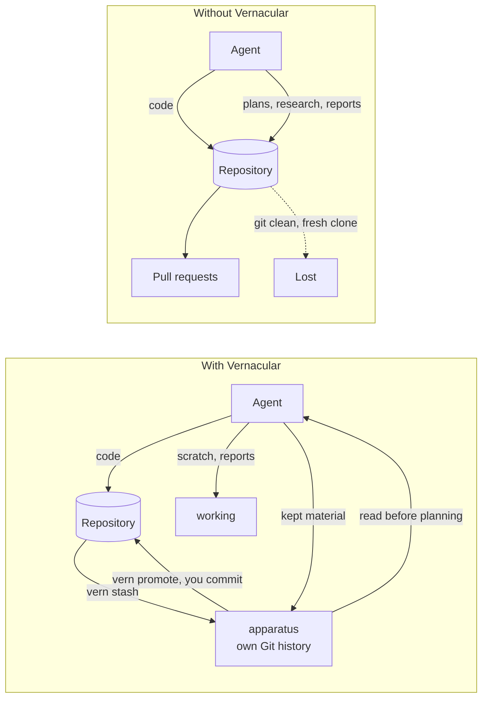

# Vernacular

Vernacular gives a Git repository two private companion spaces on your machine, so what you
and your agents produce while building a project neither lives in the repository nor gets
thrown away.

## The problem

Building with coding agents produces a second stream of material next to the code: plans,
research, reports, benchmark runs, scratch. Today it usually lands in one of three places.

- **Committed.** `PLAN.md` and `REPORT.md` at the root slip into pull requests and become
  history nobody meant to publish.
- **Hidden in the tree.** A self-ignoring folder or an exclude rule keeps it out of commits,
  but `git clean -xfd` deletes it, a fresh clone or worktree doesn't have it, and tools that
  walk the tree still trip over it.
- **Thrown away.** It stays in the chat and is gone when the session ends, so the next agent
  starts cold and redoes the research.

That material is often the best context for the work. It needs a home outside the repository
that agents can find and read.

## How it works

| Space | Holds | Lives |
|---|---|---|
| **canon** | What the project promises | The Git repository |
| **apparatus** | Durable work that is not canon: product documents, research, decisions, experiments, personal method | `~/.vern/data/<id>/apparatus`, with its own Git history |
| **working** | Scratch, agent reports, temporary output; disposable | `~/.vern/data/<id>/working` |



## Promises

What Vernacular guarantees. A change that breaks one of these is a bug.

- **No trace in the repository.** One line of local Git config. No tracked file, ignore rule,
  hook, or commit, so nothing reaches patches or pull requests.
- **Changes to the project are yours.** Material that becomes part of the project arrives as
  ordinary work you commit in the project's own style. vern never commits there, and agents
  keep Vernacular's vocabulary out of project commits, pull requests, and docs.
- **Safe from the project's Git.** Apparatus and working live outside the repository, so
  `git clean -xfd`, resets, and checkouts in the project cannot touch them. (Apparatus keeps
  its own, separate history; see [History](#history).)
- **Never overwrites.** `promote`, `stash`, and `stash --undo` refuse a destination that exists.
- **Your project's history changes only on purpose.** Tracked files move only with `--tracked`;
  `promote` copies in and never stages or commits.
- **Every move can be undone.** `stash` prints its undo; adoption writes one.
- **Kept material has save points, and you hear about them.** vern saves what it moves into
  apparatus and prints the save; agents save what they write there and tell you in one line;
  anything unsaved shows in `vern status`.
- **The attachment survives** a moved repository, worktrees, a reclone, and a lost `~/.vern`.
- **No setup, no network.** Works without a Git identity or signing setup; vern never pushes or
  fetches.
- **Agents ask once.** An agent never creates a workspace or moves your material without a
  yes, and one Enter answers.
- **Leaving is free.** Unset the config line and remove the skill link; the workspace stays
  behind as ordinary files.

## Get started

1. Install `vern`, either way (it must be on your `PATH`; `go install` puts it in
   `$(go env GOPATH)/bin`):

   ```sh
   npm install --global @grosspoetrysystems/vernacular   # prebuilt binary; the skill is inside
   go install github.com/grosspoetrysystems/vernacular/cmd/vern@latest   # or build from source
   ```

2. Install the agent skill once per machine. It is a standard [Agent Skill](https://agentskills.io)
   (a `SKILL.md` folder), so any agent that supports Agent Skills can use it:

   ```sh
   npx skills add grosspoetrysystems/vernacular -g   # links it for each agent it finds installed
   ```

   Or link `skills/vernacular` from a checkout (or from the npm package) into your agent's
   user skill directory yourself. Removing the skill is deleting the link.

3. If your agent runs in a sandbox, allow it to read and write `~/.vern`, once per machine.
4. In a repository, ask your agent to **set up Vernacular**, or run `vern init` yourself and
   then ask. The agent offers to move what you already keep in the repository into the
   workspace, then goes back to work.

Each release's checksum file is signed with cosign and carries GitHub build provenance
(`gh attestation verify FILE --repo grosspoetrysystems/vernacular`); npm packages are published
with provenance.

## What the agent skill does

The [`vernacular` skill](skills/vernacular/SKILL.md) is the whole agent integration. Nothing is
added to any repository or to your instruction files.

| Situation | The agent |
|---|---|
| The repository has a workspace | Reads apparatus and working before planning; writes scratch and reports to working and kept material to apparatus, then commits apparatus |
| No workspace, and about to plan, research, or bootstrap a project | Asks once whether to run `vern init`; Enter accepts |
| Right after `vern init`, or asked to set up | Runs adoption, once per workspace |
| Something non-project landed in the repository | Moves it out with `vern stash` |

Adoption ([`references/adopt.md`](skills/vernacular/references/adopt.md)):

- looks at what the repository already hides from Git (ignored and untracked material, read
  against your ignore rules) and describes it by kind: "benchmarks, ADRs, planning docs";
- asks one question, *Move all of it / Let me choose / Not now*, with a preview of where each
  kind goes;
- moves picked material onto shelves in apparatus with file names unchanged, and removes a
  hiding folder the move emptied;
- writes `adoption-YYYY-MM-DD.md` in apparatus with what moved and an undo block, and flags
  instructions in the repository that would send material back in;
- leaves anything you keep elsewhere (a notes folder, an app) where it is.

[`scripts/check.sh`](skills/vernacular/scripts/check.sh) confirms the attachment; `--durable`
also proves it survives `git clean -xfd`, a moved repository, a worktree, a reclone, and a
lost `~/.vern`, on a throwaway clone.

## Commands

| Command | Does |
|---|---|
| `vern init` | Attaches this repository to a new workspace; prints an optional `AGENTS.md` section for repositories you own |
| `vern attach [ID \| DIR]` | Lists workspaces, attaches to an existing one, or re-registers a moved one |
| `vern path working\|apparatus` | Prints the absolute path |
| `vern status` | Shows the workspace, recent files in each space, and apparatus changes not yet committed |
| `vern promote SRC DEST` | Copies from apparatus or working into the repository; refuses ignored destinations, and files that look like secrets or local paths unless `--allow-findings` |
| `vern stash [--apparatus] SRC [SHELF]` | Moves a path out of the repository onto a shelf in working, or apparatus to keep it, name unchanged |
| `vern stash --undo [ID]` | Puts the latest stash back, or the one with that ID |

```sh
vern stash run.log logs                # onto the "logs" shelf in working
vern stash --apparatus PLAN.md plans   # keep it: onto the "plans" shelf in apparatus
vern promote "$(vern path apparatus)/notes/design.md" docs/design.md
```

Once agents write to the workspace, little lands in the repository by mistake, so you'll
rarely need `vern stash`. It covers adoption, a misfire, or a note that became worth keeping
but not publishing. Each stash gets an ID and a line in the workspace's `stash.jsonl`; an undo
marks its line instead of deleting it, so the journal keeps the whole trail.

Run `vern help` for details.

## History

- **Apparatus is its own Git repository**, separate from the project's. `vern init` creates
  it, and adds it to existing workspaces.
- Commits there are plain save points. `vern stash --apparatus` saves each move and names the
  project commit it came from; agents save each piece of work they keep. Both tell you when
  they save, and an agent starting a session saves anything left unsaved.
- That history is private, so its messages can be as terse or idiosyncratic as suits you.
  None of it reaches the project.
- vern's own saves need no Git setup: they skip signing and use a `vern` identity if you have
  none, without changing the repository's config.
- Local only; nothing is pushed.
- **Working has no history**, by design: it is scratch.
- An apparatus path you point elsewhere (a notes folder, a shared clone) is yours to version.

## Attachment

`vern init` stores an opaque ID in the repository's local Git config (`vernacular.workspace`)
and registers the workspace in `~/.vern/workspaces/<id>`. The attachment follows the repository
when it moves and is shared by its worktrees.

```sh
vern attach                             # list registered workspaces
vern attach vrn_1a2b3c4d                # attach this repository to an existing workspace
vern attach ~/.vern/data/vrn_1a2b3c4d   # re-register a moved workspace, or a lost ~/.vern
git config --unset vernacular.workspace # detach
```

## Contributing

See `CONTRIBUTING.md`. Vernacular is [MIT](LICENSE) licensed.
